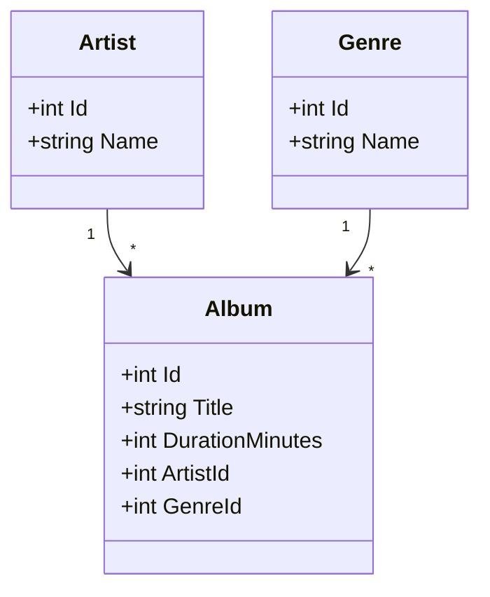
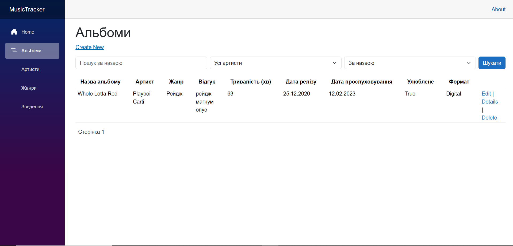
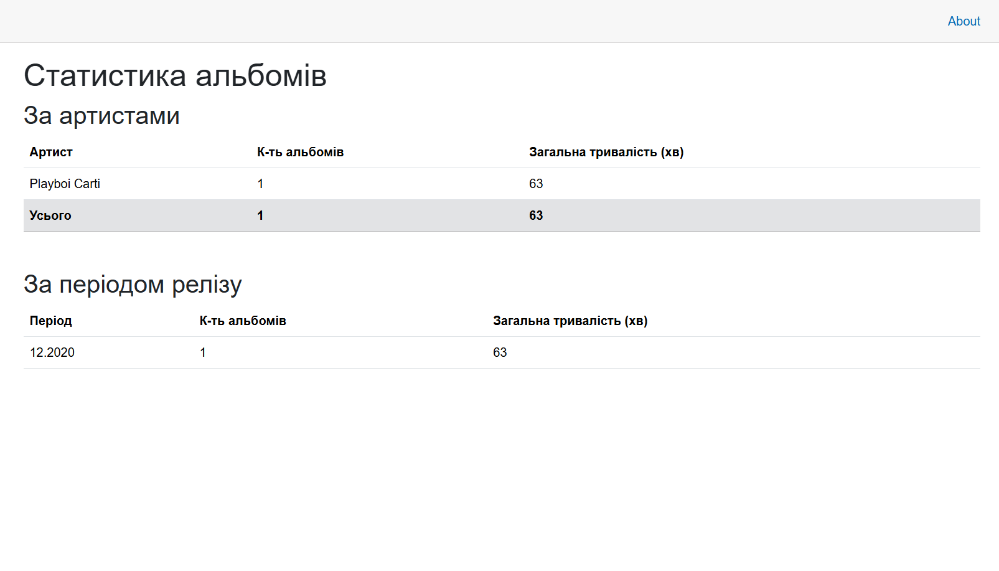
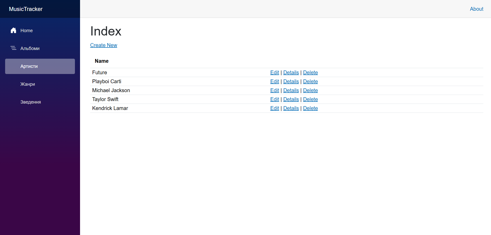

# MusicTracker
Тема №39 «Облік музичної колекції»
Вебзастосунок для обліку улюблених музичних альбомів, виконавців та статистики прослуховувань

# Основний тип даних (Album)
Запис про музичний альбом містить такі властивості:
- Id (ідентифікатор)
- Title (назва альбому)
- Review (особистий відгук)
- DurationMinutes (загальна тривалість у хвилинах)
- ReleaseDate (дата виходу)
- ListenedOn (дата прослуховування)
- IsFavorite (чи додано до улюблених)
- Format (формат носія: Digital, CD, Vinyl, Cassette)

# Особливість проєкту
Завантаження та показ зображень для записів. До кожного альбому можна буде завантажити його обкладинку (файл зображення), яка зберігатиметься на сервері та відображатиметься в каталозі та на сторінці деталей альбому.

## Діаграма класів (ЛР 7)



## Скріншоти (ЛР 10)





## Як запустити

Вимоги: встановлений **.NET 10 SDK**.

1. Клонуйте репозиторій:
   ```bash
   git clone <URL_РЕПОЗИТОРІЮ>
   cd <НАЗВА_КАТАЛОГУ_РЕПОЗИТОРІЮ>

**Запустіть застосунок:**
Bash
dotnet run

**Відкрийте адресу з виводу консолі у браузері.**

## Контейнеризація
Оскільки Docker у робочому середовищі не використовувався, порядок збірки та запуску контейнера:

**Збірка образу з каталогу MusicTracker/MusicTracker:**

Bash
dotnet publish -c Release --os linux --arch x64 -p:ContainerImageTag=latest /t:PublishContainer

**Створення тому та запуск контейнера на порту 8080 зі збереженням бази SQLite:**

Bash
docker volume create musictracker-data
docker run --rm -p 8080:8080 \
  -v musictracker-data:/home/app/data \
  -e ConnectionStrings__Default="Data Source=/home/app/data/musictracker.db" \
  musictracker:latest